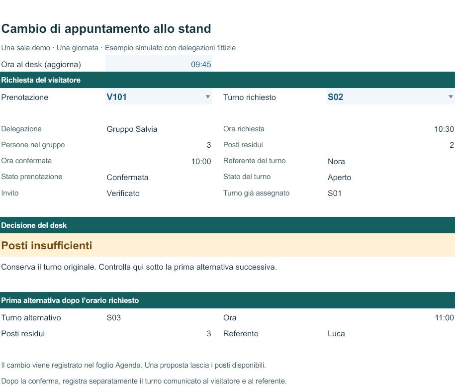

# Eventi B2B in Excel: appuntamenti allo stand e follow-up

Due fogli Excel per chi lavora agli eventi. Si aprono e si provano in un paio di minuti, senza macro. **I dati sono simulati.**

## 1. Allo stand: un gruppo chiede di cambiare orario

Sono le 09:45. Tre persone prenotate per le 10:00 chiedono di entrare alle 10:30, ma in quel turno restano due posti.

Il foglio dice a chi è al desk tre cose:

- **Cosa proporre.** Il primo turno con posto per tutto il gruppo e un referente presente: qui le 11:00.
- **Cosa non toccare.** Finché il gruppo non accetta, i suoi tre posti delle 10:00 restano occupati.
- **Chi avvisare.** Dopo il sì, l’agenda mostra se manca ancora il visitatore, il referente della sala o entrambi. Chi subentra al desk riparte da lì.

**[Scarica il foglio](fiera/agenda-demo.xlsx?raw=true)** · [Provalo in 90 secondi](fiera/README.md#prova-il-cambio-in-90-secondi)

Lo stesso metodo vale per una visita in showroom o una dimostrazione durante un open day.

## 2. Dopo l’evento: a chi passa ogni richiesta

La mattina dopo un webinar arrivano l’elenco degli iscritti e il registro degli ingressi. Non ogni ingresso è una richiesta commerciale: c’è chi entra due volte, chi vuole solo le slide e chi ha revocato il permesso a essere contattato.

Il foglio incrocia iscrizioni, presenze e CRM e divide 19 pratiche in quattro liste pronte da consegnare:

| Lista | A chi va | Righe |
| --- | --- | --- |
| [Demo da fissare](liste/demo-per-sales.csv) | Commerciali: chi richiama e cosa proporre | 3 |
| [Materiali da inviare](liste/materiali-da-inviare.csv) | Team eventi | 2 |
| [Da verificare](liste/revisione.csv) | Chi gestisce il CRM, con il controllo da fare | 11 |
| [Esclusi](liste/esclusi.csv) | Nessuno, con il motivo | 3 |

**[Scarica il foglio](riconciliazione-evento.xlsx?raw=true)** · [Come leggerlo e riusarlo](post-evento.md)

## Limiti

- Nomi, numeri e risultati sono inventati: nessuno dei due fogli è stato usato in un evento reale.
- Il foglio dello stand copre una sala e una giornata, fino a 12 turni e 40 gruppi. Quello post-evento copre un evento alla volta, fino a 30 righe per fonte.
- Entrambi sono stati aperti e ricalcolati in Microsoft Excel. Per lo stand c’è uno [script con 30 controlli](fiera/verifica-excel.ps1).
