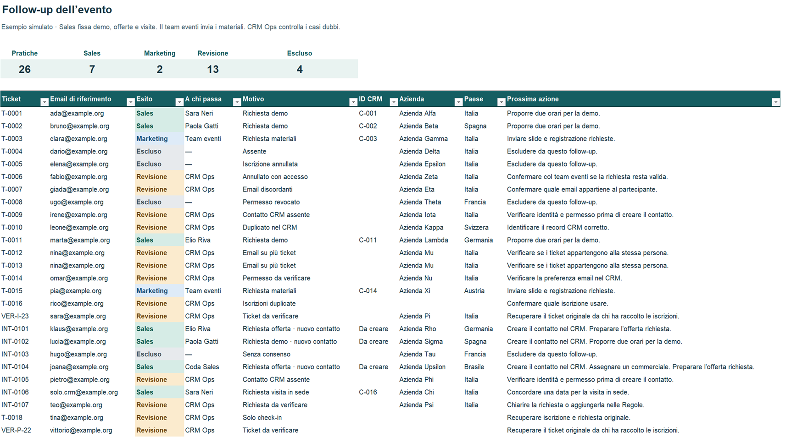

# Eventi B2B in Excel: appuntamenti allo stand e follow-up

> **English summary (full README in Italian below):**
> - **What it is:** Two macro-free Excel workbooks built for B2B trade shows and in-house open days (simulated data, ready to validate on anonymised event records).
> - **1. Stand appointments (`fiera/agenda-demo.xlsx`):** Proposes the first free slot in the same area/day without dropping the original booking until confirmed, and automatically flags visitors or hosts who still need an update if a slot shifts (62 automated checks).
> - **2. Post-event follow-up (`riconciliazione-evento.xlsx`):** Reconciles registrations, attendance, booth scans and CRM consents into four ready-to-hand-off lists — *Sales*, *Events/Materials*, *CRM Review* and *Excluded* — with all routing rules editable in a single *Regole* sheet.

**Questo è un esercizio con dati simulati. La prima prova su un evento reale è ancora da fare.** I due fogli mostrano come terrei aggiornata l’agenda di uno stand e come passerei le richieste ai colleghi dopo un evento in sede o una fiera. Si possono provare in Excel in un paio di minuti, senza macro.

## 1. Allo stand: un gruppo chiede di cambiare orario

Sono le 09:45. Tre persone prenotate per le 10:00 chiedono di entrare alle 10:30, ma in quel turno restano due posti.

Il foglio dice a chi è al desk tre cose:

- **Cosa proporre.** Il primo turno con posto per tutto il gruppo e un referente presente, nella stessa area e giornata: qui le 11:00.
- **Cosa non toccare.** Finché il gruppo non accetta, i suoi tre posti delle 10:00 restano occupati.
- **Chi avvisare.** Dopo il sì, l’agenda mostra se manca ancora il visitatore, il referente della sala o entrambi. Se poi un turno slitta o cambia referente, i gruppi interessati tornano da avvisare. Chi subentra al desk riparte da lì.

**[Scarica il foglio](fiera/agenda-demo.xlsx?raw=true)** · [Provalo in 90 secondi](fiera/README.md#prova-il-cambio-in-90-secondi)

Lo stesso metodo vale per una visita in showroom o una dimostrazione durante un open day.

## 2. Dopo l’evento: a chi passa ogni richiesta

Dopo un evento arrivano l’elenco degli iscritti, il registro degli ingressi e i contatti raccolti allo stand. Non ogni nome è una richiesta commerciale: c’è chi entra due volte, chi vuole solo le slide e chi non ha dato il permesso a essere contattato.

Il foglio incrocia questi elenchi con il CRM e divide 26 pratiche in quattro liste pronte da consegnare:

| Lista | A chi va | Righe |
| --- | --- | --- |
| [Richieste per Sales](liste/richieste-per-sales.csv) | Commerciali: demo, offerte e visite, con chi richiama | 7 |
| [Materiali da inviare](liste/materiali-da-inviare.csv) | Team eventi | 2 |
| [Da verificare](liste/revisione.csv) | Chi gestisce il CRM, con il controllo da fare | 13 |
| [Esclusi](liste/esclusi.csv) | Nessuno, con il motivo | 4 |

Un contatto nuovo raccolto allo stand, con il consenso, va al commerciale del suo paese con l’indicazione di crearlo nel CRM. Categorie di richiesta, commerciali per paese e diciture del permesso stanno nella scheda **Regole**: si cambiano lì, senza toccare le formule.

Se un contatto già presente nel CRM rifiuta il follow-up allo stand, una preferenza CRM favorevole apre una revisione. Anche un record CRM con ID mancante passa al team che gestisce i dati prima di essere assegnato.

**[Scarica il foglio](riconciliazione-evento.xlsx?raw=true)** · [Come leggerlo e riusarlo](post-evento.md)

## Perimetro e verifica

- **Stand.** Più giorni e più aree, fino a 150 turni e 300 gruppi. Un operatore alla volta conferma gli spostamenti. [Collaudo del desk](fiera/verifica-excel.ps1): 62 controlli.
- **Post-evento.** Fino a 500 iscrizioni o contatti, 500 ingressi e 5.000 contatti CRM. Il collaudo ricalcola 26 pratiche, controlla cinque liste CSV e prova modifiche ai dati e alle regole. [Collaudo del follow-up](verifica-post-evento.ps1)
- **Fuori dai fogli.** Due postazioni che modificano insieme la stessa agenda, l’invio delle email e l’aggiornamento del CRM: i fogli preparano le liste, non le spediscono. Fornitori, budget e logistica sono fuori dal perimetro dei due casi.

**Una prova su un evento reale.** Con chi ha gestito un evento, riprenderei tre cambi di orario già chiusi, usando dati anonimizzati. Confronterei il turno proposto e gli avvisi rimasti aperti con le decisioni effettive del desk. Per il follow-up, farei verificare a un commerciale la destinazione di un piccolo campione di richieste e annoterei i casi in cui sceglierebbe diversamente.
